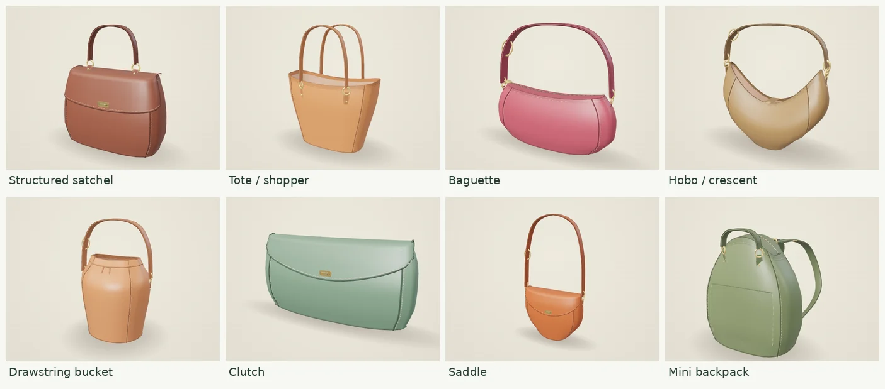
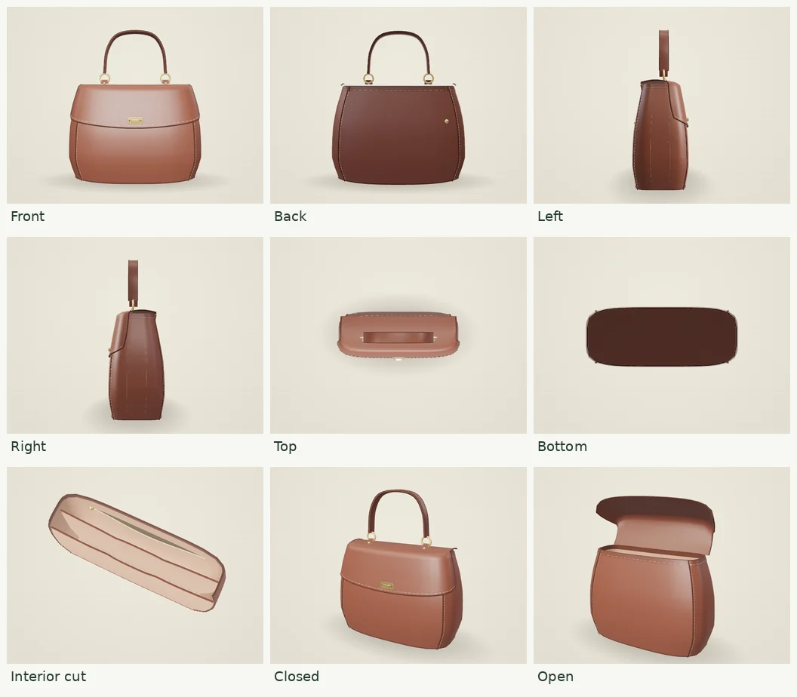

# RAWNAK FIT Bag Atelier

The structure-first builder makes an editable handbag from a family pattern, centimetre measurements and a merchant’s construction description. It runs locally in Arabic or English. Choose **Structure → Photos → Construct → Review → Export**. Selecting a family updates its suggested measurements and hardware while retaining customized values. The separate photo-only intake and live try-on routes have their own inputs. [Bag Atelier](https://altaqawy.github.io/rawnak-fit-ai/studio/bag-builder.html) · [Photo-Only Studio](https://altaqawy.github.io/rawnak-fit-ai/studio/library.html)



## Implemented and exercised

| Area | Current behavior |
| --- | --- |
| Pattern geometry | Satchel, tote, baguette, hobo, bucket, clutch, saddle and mini backpack use independent width, depth and rim/base profiles. Family construction includes crescent cutaways, bucket gathers, an asymmetric saddle base or a domed backpack. Shared parametric sections join four cut panels to the floor and turned opening. The inside shell, lining, optional base insert, bindings and stitch rows have UVs and independent part identities. |
| Interior | One to five inspectable volumes occupy the cavity. Dividers meet the shell. Open, zipped, outer, card and accessory pouches have a backing, a sewn edge and a free lip. A fabric tape and slider open zipped pouches. Interior camera and front section controls expose their placement. Counts and positions originate in the spec. |
| Mechanics | Flat or folded carriers swing about the line through their two rings. Their centreline length and minimum span are reported when the requested length is infeasible. A short top handle on a hinged lid rides with that lid. Turn-lock and buckle flaps, zipper tapes and teeth, snaps/buttons and gathered drawstring mouths have constrained opening controls. Metal rings, sewn tabs, sliders, adjustment hardware and detachable clips are modeled. |
| Appearance | PBR presets cover leather, synthetic leather, suede, canvas, nylon, weave, rigid plastic, hardware and linings. The defaults include procedural micro-normals. A merchant can explicitly assign tileable color, normal, roughness, metalness and AO maps. Assigned logo art preserves alpha and aspect ratio. Rights confirmation enables logo artwork or lettering. The emboss/deboss option derives surface normals from an alpha mask. |
| Editor | Raycast picking or the component tree selects a part. Review shows its connections, bounds, joint limits and reference names. Linked dimension and curvature edits rebuild dependent panels. Carry length/width/mount, pocket placement/width, surface roughness, visibility and available motion ranges have constrained controls. Stiffness and movement declarations on an unrigged part are descriptive. Undo, redo, part reset and five bounded bilingual commands operate locally. |
| Evidence and feedback | File hashes support relinking after renaming. Capture requirements reflect the construction. Missing evidence, filename hints, merchant-assigned views and model verification are distinct. Approved corrections retain original/corrected values, component, family, evidence and approval in the editable file. Explicit approval also saves the latest project metadata in this browser. Shared training is disabled. |
| Delivery | The static page serves its pinned Three.js runtime and license locally. The GLB, graph and editable project are independent downloads. Mobile and detailed export profiles use different tessellation and texture limits. The live AR runtime is independent. |

## Photo processing and its limits

The local pipeline downsamples each image for analysis. It uses alpha or contrast against a sufficiently uniform border, extracts the largest connected component, and rejects low coverage, clipping and competing foreground objects. Broad, occupied image rows provide a five-level body-width estimate that reduces handle influence. A confirmed straight front or back view can fit the template within the design dimensions. Competing assigned frontal envelopes can invalidate a previous fit. The source comparison shows the selected view beside the render on wide screens.

The chosen template and its unseen surfaces remain estimates. The body fit adjusts a width envelope. Side depth, physical dimensions, seams, true material properties, interior counts and hidden details require measurements or review. Close-up swatches repeat across UVs. Unwrapped photographic texture baking, arbitrary viewpoint recovery, semantic part segmentation and trained interior inference remain unavailable. The handheld appearance is kinematic. Collision handling, gravity-driven strap drape, sewing allowances, physical cloth and material testing remain open.

The optional provider interface receives an explicit stage, the spec, evidence metadata and an abort signal. Findings must identify source records. The default deployment has no remote worker, inference fees or credential requirement. Stage failures and absent capabilities remain visible in the exported reconstruction record. [Pipeline](../studio/bag-evidence.js)

## Export and AR handoff

| File | Contract |
| --- | --- |
| `.fit.json` | Authoring spec in cm, part overrides, fitted profile, evidence identities, stage results when run, approval and correction history. Images remain with the merchant. Open the project and choose the original files to restore textures and comparisons. The reader also accepts the original v1 builder draft. |
| `.parts.json` | Independent metre-based graph with stable IDs, semantic parents, scene-node names, bounds, anchors, geometry constraints, materials, evidence and verification. Empty compartment records describe free space. The frame is right-handed, Y-up and +Z front, with the origin at the base centre. Carry modes point to named grip and attachment nodes. |
| `.glb` | Neutral, closed assembly with named anchors and extras. Supported closure, carrier and pocket movements are baked as glTF clips using transforms and morph weights. Intentional hidden overrides are honored. The review camera, selection tint and section cut are transient. A consumer can play each clip independently. |

The sample has three main compartments and uses the mobile export profile. Its PBR surfaces and form come from the template. [Download sample GLB](https://altaqawy.github.io/rawnak-fit-ai/docs/bag-qa/satchel-mobile.glb) · [Sample graph](bag-qa/satchel-mobile.parts.json)

## Rendering and regression checks

The real-browser suite exercises the five-step merchant workflow, mouse selection, a linked edit, undo/redo, photo assignment, fitting, approval, downloadable files, reload and digest-based relinking. The source fixture is synthetic and includes a transparent logo. A separate scene loads the exported GLBs using Three.js GLTFLoader, renders pixels, checks logo alpha, validates anchor presence and plays the exported closure clip. Cases cover a flap, zipper, drawstring and magnetic fastener. Seventeen tolerant image signatures cover eight families, six orthogonal views, an interior section and open/closed states. The suite also checks a 390-pixel viewport and renderer allocation counts over twelve rebuilds.



The reference run used Chromium with software WebGL. In twelve alternating rebuilds the repeated satchel returned to 70 allocated geometries and five textures. These are renderer counters. Device VRAM, frame rate and sustained power on Android and iOS still require hardware measurement. [Measured results](bag-qa/report.json) · [Arabic desktop](bag-qa/atelier-ar.webp) · [Mobile viewport](bag-qa/mobile.webp) · [Source comparison](bag-qa/comparison.webp)

From the repository root:

```sh
npm ci --prefix studio
node --test studio/tests/*.test.mjs tests/*.test.mjs
npm run vendor:check --prefix studio
BAG_CHROMIUM=/path/to/chrome npm run test:bag:browser --prefix studio
```

The browser test starts an ephemeral local HTTP server and writes screenshots, the sample binary, graph and metrics under `studio/test-results/browser/`. After a deliberate visual change, inspect the images before recording the corresponding signatures with `--update-baseline`. Refresh the vendored Three.js subset after updating its pinned version with `node studio/scripts/sync-three.mjs`.

## Production work and technology choices

1. Pilot one consented merchant SKU with measured exterior and interior, labelled views, open/closed and macro photographs. Establish per-view silhouette error, attachment distances and pocket-count agreement against those observations.
2. Evaluate a private, per-SKU segmentation worker with landmarks and a handbag-specific labelled validation set. SAM 2 provides promptable masks. Its core checkpoints and inference code are Apache 2.0. Semantic labels and reliable viewpoints still need task-specific work and GPU benchmarking. [SAM 2 and license](https://github.com/facebookresearch/sam2#license)
3. Compare multiview calibrated fitting against an image-to-mesh baseline. TripoSR provides single-image geometry with MIT-licensed weights and code. Its published default uses approximately 6 GB of VRAM. Its mesh cannot establish hidden pocket construction. Budget compute per preparation job, cache explicit results, and measure failure cost. [Model implementation](https://github.com/VAST-AI-Research/TripoSR) · [License and scope](https://stability.ai/news-updates/triposr-3d-generation)
4. Keep editable patterns as the construction source. GarmentCode is an MIT-licensed reference for parametric sewing patterns. Innerscene's CC0 satchel is a potential measured external visual benchmark. This release uses original generated geometry and includes no third-party handbag meshes or model weights. [GarmentCode](https://github.com/maria-korosteleva/GarmentCode) · [Satchel listing and license](https://www.innerscene.com/tools/library/3d-parts/handbag-e3e356ca)
5. Validate multi-view UV baking, logo placement and deformation against licensed source images. Maintain separate, explicit permission for a future training dataset, version its examples and evaluate changes offline.
6. Integrate the handoff with hand, shoulder and crossbody tracking in the separate AR engine. Measure scale, tracking loss, depth/occlusion, skin/cloth contact, load time and sustained frame rate on physical Android and iOS devices before retail publication.
